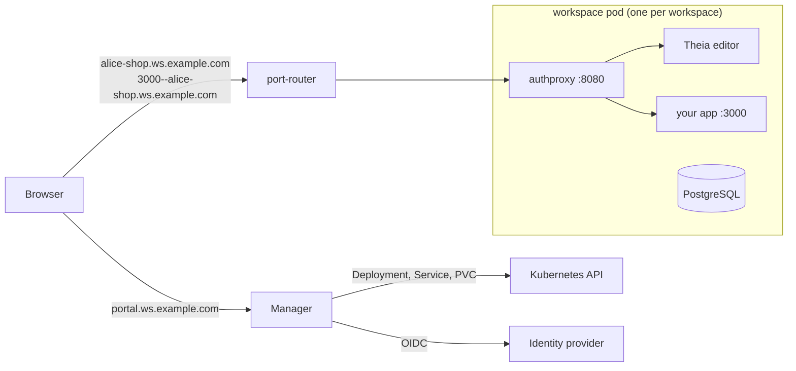

# Workspaces

Self-hosted, browser-based development environments on Kubernetes, with AI
coding assistants built in.

Each person names a workspace in a small portal and gets a private pod. It
has a persistent home folder, a full editor in the browser, the usual
toolchains, a PostgreSQL database, and an HTTPS address for whatever they
run. Idle workspaces stop by themselves and start again in seconds.

- **Theia editor** in the browser: files, terminals, a live Preview of
  what you're building, and a Running panel with every port your app opens.
- **Three assistants**, side by side:
  - **Claude Code**, signed in with each person's own Claude account.
  - **OpenCode** and **Pi**, running on any inference provider you
    configure (OpenAI, OpenRouter, vLLM, Ollama, Azure OpenAI, or anything
    else with an OpenAI-compatible API).
- **Your app on its own URL:** `https://3000--alice-shop.ws.example.com`.
  Every port is private to the workspace's owner; there is no public exposure.
- **Batteries included:** Go, Node.js, Python, git and the GitHub CLI, plus
  PostgreSQL on `localhost:5432`.
- **Stops when idle, keeps the disk:**
  - An idle workspace stops after 30 minutes and its disk is kept.
  - A workspace unused for weeks is flagged on its card and then removed.
  - Both are configurable.
- **Small control plane:** one Go service and plain Kubernetes objects (a
  Deployment, Service and PVC per workspace). No operator, no CRDs.
- **Any OpenID Connect login:** Keycloak, Entra ID, Google, Dex and others.

## Install

You need:
- a Kubernetes cluster;
- an ingress controller or a Gateway API implementation;
- a wildcard DNS record and TLS certificate for a domain (e.g. `*.ws.example.com`);
- an OpenID Connect client with the redirect URI
  `https://portal.ws.example.com/auth/callback`.

```sh
helm install workspaces oci://ghcr.io/alfredtm/charts/workspaces \
  --namespace workspaces --create-namespace \
  --set domain=ws.example.com \
  --set oidc.issuer=https://login.example.com/realms/main \
  --set oidc.clientId=workspaces \
  --set routing.ingress.className=nginx \
  --set routing.ingress.tlsSecretName=ws-wildcard-tls
```

Then open `https://portal.ws.example.com`. Every option (Gateway API,
storage, limits, inference providers, OpenShift) is in
[`charts/workspaces/values.yaml`](./charts/workspaces/values.yaml) and
[`docs/deployment.md`](./docs/deployment.md).

### Inference providers (optional)

OpenCode and Pi talk to any OpenAI-compatible API:

```yaml
inference:
  providers:
    - label: OpenRouter
      baseUrl: https://openrouter.ai/api/v1
      apiKey: sk-or-...
      models: anthropic/claude-sonnet-4.5,qwen/qwen3-coder
    - label: Local
      baseUrl: http://ollama.ai.svc:11434/v1
      models: qwen3-coder:30b
```

Claude Code needs nothing here: people sign in with their own Claude account
inside their workspace. See [`docs/inference.md`](./docs/inference.md).

## How it works



- **manager** (Go): handles login, serves the portal and its API, and
  creates, starts, stops and deletes workspaces. It is stateless, so it can
  run with several replicas.
- **port-router**: sends every `*.<domain>` host to the right workspace.
- **authproxy** runs in every workspace pod:
  - It checks the session cookie and that the visitor owns the workspace.
  - It forwards to the editor or to the app's port.
  - It reports activity, which is how idle workspaces get stopped.

More in [`docs/architecture.md`](./docs/architecture.md).

## Repository

| Path | What |
|---|---|
| [`services/manager`](./services/manager) | Control plane: login, API, workspace lifecycle |
| [`services/authproxy`](./services/authproxy) | Per-workspace auth and port proxy (built into the image) |
| [`services/port-router`](./services/port-router) | Routes workspace and port hostnames |
| [`services/shell`](./services/shell) | In-workspace agent the editor uses (ports, preview, files, sign-ins) |
| [`services/pi`](./services/pi) | The Pi assistant's server |
| [`ui/portal`](./ui/portal) | The portal (React), embedded in the manager |
| [`ui/theia`](./ui/theia) | The editor (Theia app and extension) |
| [`images/workspace`](./images/workspace) | The workspace image |
| [`charts/workspaces`](./charts/workspaces) | Helm chart |
| [`docs`](./docs) | Architecture, deployment, development, inference |

## Development

See [`docs/development.md`](./docs/development.md) and
[`CONTRIBUTING.md`](./CONTRIBUTING.md).

## Background

Workspaces started as an internal platform for giving everyone at a company,
developers or not, a safe place to build with AI assistants. It is no longer
developed there, so it lives on here as open source.

## License

[MIT](./LICENSE)
