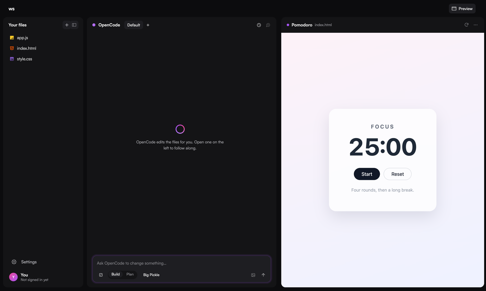
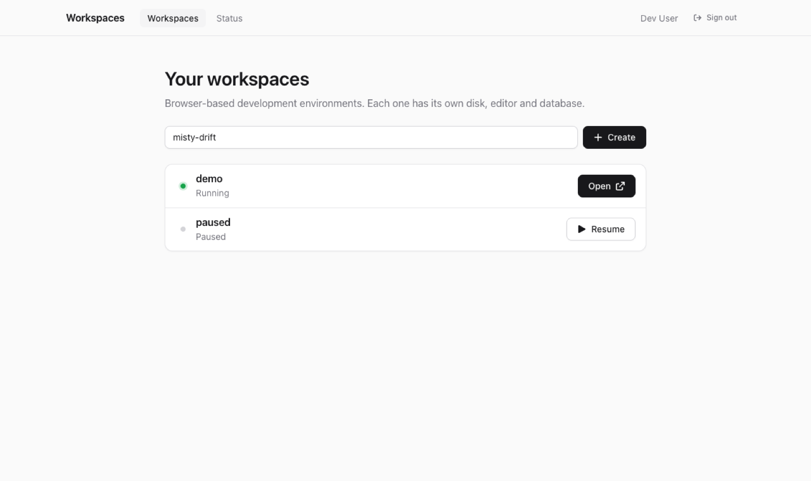

# Workspaces

Browser-based development environments on your own Kubernetes cluster.
Everyone gets their own workspace with an editor, terminals, Claude Code,
OpenCode and Pi, a PostgreSQL database, and a private URL for whatever they
run.



## Install

You need a cluster with an ingress controller (or Gateway API), a wildcard
DNS record and certificate for a domain, and an OpenID Connect client.

```sh
helm install workspaces oci://ghcr.io/alfredtm/charts/workspaces \
  --namespace workspaces --create-namespace \
  --set domain=ws.example.com \
  --set oidc.issuer=https://login.example.com/realms/main \
  --set oidc.clientId=workspaces
```

The portal is then at `https://portal.ws.example.com`. See
[docs/deployment.md](docs/deployment.md) for TLS, Gateway API, OpenShift
and the other options, and [docs/inference.md](docs/inference.md) to connect
OpenCode and Pi to a model provider.



## How it works

A small Go service handles login and creates a Deployment, a Service and a
volume per workspace. A router sends `<user>-<name>.<domain>` to the
workspace, and `<port>--<user>-<name>.<domain>` to a port inside it. A proxy
in each workspace checks that the visitor owns it. Idle workspaces stop
after 30 minutes and keep their files.

More in [docs/architecture.md](docs/architecture.md). Development setup is
in [docs/development.md](docs/development.md).

## License

[MIT](LICENSE)
