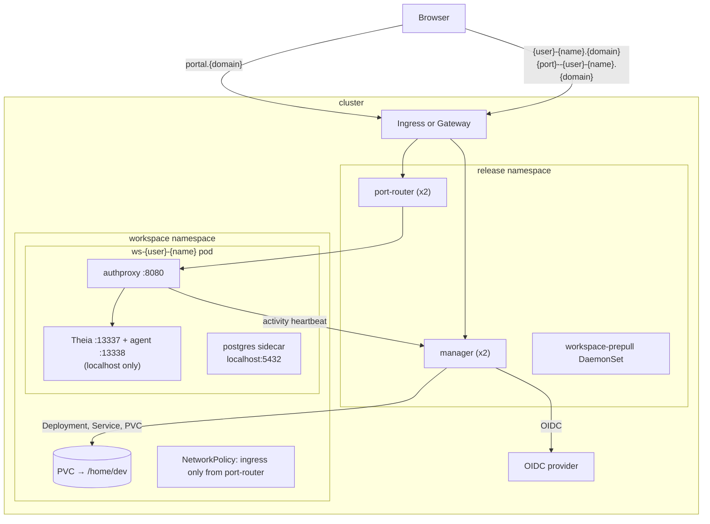

# Architecture

How a workspace request becomes a running pod, and what runs inside it.

## Components

- **manager** (`services/manager`, Go): the only stateful-looking part,
  except that it isn't. It handles:
  - OIDC login and the session cookie,
  - the portal (embedded React app) and its JSON API under `/api/v1`,
  - workspace create, start, stop and delete,
  - stopping idle workspaces, and idle retention.

  Its state lives in labels and annotations on the workspace Deployments, so
  any replica can serve any request.
- **port-router** (`services/port-router`, Go, stdlib only): the backend for
  the wildcard host. `<user>-<name>.<domain>` goes to Service
  `ws-<user>-<name>`, and `<port>--<user>-<name>.<domain>` goes to the same
  Service with the port in the Host header. It never routes the portal host.
  It has no auth of its own.
- **authproxy** (`services/authproxy`, Go, built into the workspace image):
  the only listener a workspace exposes (`:8080`). It does four things:
  - verifies the session cookie locally with the manager's public key, and
    that the visitor owns the workspace;
  - proxies to the editor or, for `<port>--…` hosts and `/proxy/<port>/`
    paths, to `localhost:<port>`;
  - counts every byte (WebSocket frames included) as activity, and reports
    it to the manager every 60 seconds;
  - serves `/_workspace/healthz` for the pod's probes.
- **agent** (`services/shell/agent.js`, Node): a small local server the
  editor talks to (through Theia's backend at `/workspace-api`). It serves:
  - listening ports and their URLs,
  - Preview pages,
  - file uploads,
  - per-user environment variables (`~/.workspace/env`),
  - guided sign-ins (GitHub, Claude) in a terminal.
- **Theia** (`ui/theia`): the editor, with the `workspace-theia` extension
  (layout, assistant card for OpenCode and Pi, Preview, Running, Files,
  Settings) and the Claude Code plugin.
- **Pi** (`services/pi`): the Pi assistant's server. It speaks the subset of
  OpenCode's HTTP API the assistant card uses, so the card serves both.

## Workspaces

A workspace is created name-only in the portal. The API also accepts
`repoUrl`, which the image clones on first boot. A workspace is three objects
in the workspace namespace, all named `ws-<user>-<name>`:

- **PVC** (`WORKSPACE_STORAGE_SIZE`, default 10Gi), mounted at `/home/dev`.
  It survives stop and start, and is only deleted with the workspace.
- **Deployment** (Recreate, replicas 0 or 1):
  - the `workspace` container;
  - the PostgreSQL sidecar (`localhost:5432`, user, password and database
    `dev`). It is on unless the create request says `postgres:false`.
- **Service** `:80 → :8080`.

Ownership is an exact `workspaces.dev/user` label match, never parsed from
the name. `<user>` and `<name>` together stay under 56 characters, so
`<port>--<user>-<name>` still fits in one DNS label. Pods run with:
- `automountServiceAccountToken: false` (no Kubernetes credentials inside);
- `enableServiceLinks: false` (no other workspaces' service names in the env);
- `fsGroup` 1000 by default, so the home volume is writable on any cluster.
  On OpenShift, set it to null and the SCC assigns ids.

## Auth and sessions

- **Login:** OIDC authorization code flow with PKCE, against any provider.
  `OIDC_CLIENT_SECRET` is optional, for confidential clients.
  `ALLOWED_EMAIL_DOMAINS` optionally limits who may log in.
- **Session:** an 8-hour, Ed25519-signed, stateless cookie.
  - Any manager replica verifies any cookie.
  - Workspace pods verify it locally with the public key.
  - Rotating `SESSION_PRIVATE_KEY` logs everyone out.
  - CSRF tokens use a separate `CSRF_KEY`.
- **Cookie domain:** the session cookie is scoped to the parent of the portal
  host. With the portal at `portal.ws.example.com` that is `.ws.example.com`,
  which covers every workspace host. Keep the portal one label under
  `domain`.

## Ports

Both forms need the session cookie of the workspace's owner. There is no
public, unauthenticated exposure.

1. **Host-based:** `https://<port>--<user>-<name>.<domain>/`. The app gets
   the URL root, so absolute asset paths work.
2. **Path-based:** `https://<user>-<name>.<domain>/proxy/<port>/`.

Ports taken inside every pod:

| Port | What |
|---|---|
| 8080 | authproxy (the only port reachable from outside the pod) |
| 13337 | Theia (localhost) |
| 13338 | agent (localhost) |
| 13339 | Preview page server (localhost) |
| 4097 / 4099 | OpenCode / Pi servers (localhost) |
| 5432 | PostgreSQL |

User apps get `PORT=3000` and can use any other port.

HTML pages served through a forwarded port get a thin banner on top, "Dev
workspace · only accessible to you · not a deployment", so nobody mistakes a
preview for something published. It has a close button that hides it until
the next reload. Other content types pass through untouched.

## Idle workspaces

- **Stopping:** a workspace idle for `IDLE_TIMEOUT` (default 30 minutes) is
  scaled to zero; its disk stays. An open editor tab keeps it alive, because
  the editor holds WebSockets open. Activity is persisted in the
  `workspaces.dev/last-activity` annotation, so it survives manager restarts.
- **Removal:** after `IDLE_WARN_DAYS` (default 7) a stopped workspace's card
  shows a warning. After `IDLE_DELETE_DAYS` (default 14) it is deleted, disk
  included. Running workspaces are never deleted.
- **Stuck starts:** a pod still not ready after `START_TIMEOUT` (default 10
  minutes) is stopped, and the card says why.
- **Limit:** `ACTIVE_LIMIT` (default 3) caps how many workspaces one person
  runs at once.

## Assistants

- **Claude Code** comes as the editor plugin plus the CLI. Each person signs
  in with their own Claude account; no organization key is injected.
- **OpenCode** and **Pi** use the inference providers configured in the chart
  (`LLM_*` env, see [inference.md](./inference.md)), and show up as one model
  list in the assistant card.
- Each assistant gets a short environment guide in the image (a Claude skill,
  and an `AGENTS.md` for OpenCode). It explains the editor, Preview, ports
  and the database, so the assistant gives people working links.
